# MLDS 490 — Homework 1

**Student:** Shiva (Northwestern MSAI)

**GitHub username:** `<<GITHUB_USERNAME>>`

**Repository:** `<<REPO_NAME>>`

**Link:** `<<GITHUB_LINK>>`

**AI assistance.** Cursor (an AI coding assistant) wrote the implementation, ran the experiments, and drafted this report from the files those runs produced. The lr 0.01 Pong runs are the primary Part 2 and Part 3 results. The lr 0.001 pair was added afterwards, after those runs and after the 2000-episode sweep were already in hand. The numbers below are copied from `results/` and from the validation logs; they are not the "expected" column of the plan. I am responsible for being able to explain every design choice. The companion explanation is `STUDY_GUIDE.md`.

---

## How to run

Quote the local path. The folder name contains `#`.

```bash
cd "/Users/sbboss/NU/Q4/MLDS-490/HW#1"
python3 -m venv .venv && source .venv/bin/activate
pip install -U pip && pip install torch && pip install -r requirements.txt
```

**Part 1** (CPU, about 2 seconds on the laptop used here; 29 pytest checks plus 38 validation checks):

```bash
cd shuttle
python run_shuttle.py && python validation.py && python -m pytest -q test_shuttle.py
cd ..
```

**Policy-gradient validation** (CPU; the Pong block needs ale-py and takes a few minutes):

```bash
python -m validation.run_validation
python -m validation.run_validation --pong
python -m validation.test_tb5          # gradient-variance experiment, after C0 seed 0 exists
```

**CartPole** (CPU, one seed, 2000 episodes, a few minutes):

```bash
python -m pg.train_cartpole --baseline none --seed 0 --episodes 2000 \
    --out results/cartpole/C0_none/seed0
python -m pg.evaluate --env cartpole --run results/cartpole/C0_none/seed0
python -m pg.plot_results
```

The full matrix (C0–C5 and the two labeled fallbacks C7, C8) is `scripts/run_cartpole_all.sh` on deepdish, or the same flags locally. Headline figures use **seed 0**.

**Pong** (deepdish, exactly one GPU). Torch enumerates the RTX PRO 5000 as device 0, which is `nvidia-smi` index 1. Check `nvidia-smi` and confirm only that card has memory.

```bash
ssh hia9393@mlds-deepdish5.ads.northwestern.edu
cd ~/mlds490_hw1 && source ~/venvs/mlds490/bin/activate
export CUDA_VISIBLE_DEVICES=0          # the 48 GB card; see DECISIONS D23
export OMP_NUM_THREADS=1
nice -n 10 python -m pg.train_pong --baseline none --lr 0.01 --workers 16 \
    --episodes_per_update 16 --max_episodes 25000 --max_hours 4 --seed 0 \
    --out results/pong/P0_none/seed0
python -m pg.evaluate --env pong --run results/pong/P0_none/seed0 --workers 16
```

Part 3 is the same command with `--baseline value` (learned state-value) or `--baseline ema`. `tmux` is not installed on this node; long jobs are `nohup setsid` and write `log.txt`. Pull artifacts with `bash scripts/sync_down.sh`.

The extended runs are not a replacement for the command above. They use lr 0.001, turn the moving-average early-stop off, and stop at 3 hours. Both were started together, 16 workers each, on the same GPU (`CUDA_VISIBLE_DEVICES=0`, the 48 GB card).

```bash
env CUDA_VISIBLE_DEVICES=0 OMP_NUM_THREADS=1 MKL_NUM_THREADS=1 \
  nice -n 10 python -m pg.train_pong --baseline none --lr 0.001 \
    --workers 16 --episodes_per_update 16 --max_episodes 1000000 \
    --max_hours 3 --early_stop 0 --seed 0 \
    --out results/pong/ext_P0_lr1e-3/seed0
env CUDA_VISIBLE_DEVICES=0 OMP_NUM_THREADS=1 MKL_NUM_THREADS=1 \
  nice -n 10 python -m pg.train_pong --baseline value --lr 0.001 \
    --workers 16 --episodes_per_update 16 --max_episodes 1000000 \
    --max_hours 3 --early_stop 0 --seed 0 \
    --out results/pong/ext_P1_lr1e-3/seed0
python -m pg.evaluate --env pong --run results/pong/ext_P0_lr1e-3/seed0 \
    --n 500 --seed 10000 --workers 16
python -m pg.evaluate --env pong --run results/pong/ext_P1_lr1e-3/seed0 \
    --n 500 --seed 10000 --workers 16
```

**Hardware used.** Laptop for Part 1, CartPole, and the validation suite. deepdish (`mlds-deepdish5`) for Pong: one GPU (RTX PRO 5000 Blackwell, 48 GB), 16 actor processes per job, at most 32 actors across jobs, `nice -n 10`. Remote stack, recorded in `results/env_versions.txt`: Python 3.13.5, torch 2.11.0+cu128, numpy 2.5.4, gymnasium 1.4.0, ale-py 0.12.1, CUDA driver 615.71 / CUDA 13.4. A 512×512 matmul on the GPU succeeded at setup.

**Runtimes actually observed.** Part 1 re-run: 2.4 s including pytest. CartPole matrix C0–C5 (up to 6 seeds at a time): about 4 minutes on the laptop. One Pong learning-rate run of 2000 episodes: 148–272 s depending on whether rallies got longer. A 500-episode CartPole evaluation is a few seconds if the policy fails immediately and about a minute if it survives to the 500-step cap.

---

## Part 1 — Shuttle dispatch

### Model and assumptions

State `s` is the number of customers waiting, `s = 0, …, 200`. Each period the action is hold or dispatch. Cost is `cf · 1[dispatch] + ch · (customers left waiting after the decision, before arrivals)`, with `cf = 100` and `ch = 2`. Arrivals are `A ~ Uniform{1,…,5}`. The next state is `min(200, leftover + A)`. Arrivals that would pass 200 are discarded for free. Costs are minimized. A tie (difference at most `1e-9`) is broken toward hold, so the policy dispatches only when dispatch is strictly better. Arithmetic is float64. Discount `γ = 0.95`.

"Enumeration" means backward induction over all `T = 500` stages. A literal tree of `2^500` action sequences is impossible. The test that *does* enumerate is a 12-step problem with deterministic arrivals (`2^12 = 4096` sequences). It matches the DP to `1e-13`.

### Results

| quantity | measured |
|---|---|
| `V_0(0)` at `T = 500`, and `V*(0)` | 576.6702 |
| `V*(15)` | 676.6702 (= `V*(0) + 100`) |
| `V*(200)` | 3821.586 |
| optimal policy, all three methods | dispatch iff `s ≥ 13` |
| value-iteration iterations (`ε = 1e-10`) | 580 |
| policy-iteration iterations (start: always hold) | 6 |
| max `|V_0(T=500) − V*(VI)|` | 4.86e-9 |
| Monte Carlo of the optimal policy from `s = 0` | 576.56 ± 0.16 (SE) |
| average cost per period `g` | 32.34 |
| dispatch frequency | 0.2133 |

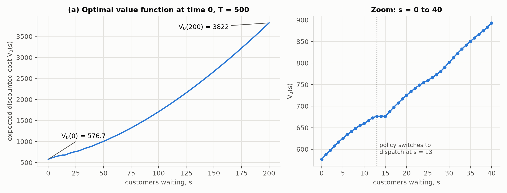

*Figure 1. Optimal value at time 0 against customers waiting, from exhaustive backward induction over T = 500. The curve is the finite-horizon value; it agrees with the infinite-horizon value to 5e-9, so the horizon is already the steady problem.*

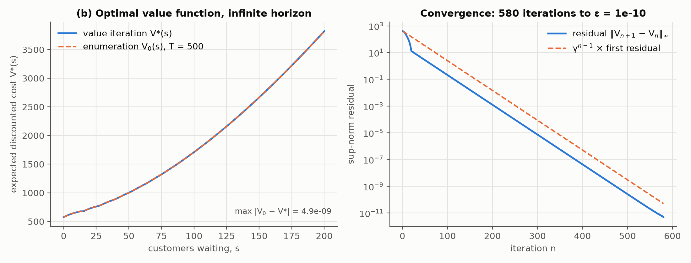

*Figure 2. `V*` from value iteration. The flat stretch on `s = 13, 14, 15` is the dispatch region: those states all pay 100 and empty the queue, so they share the same continuation.*

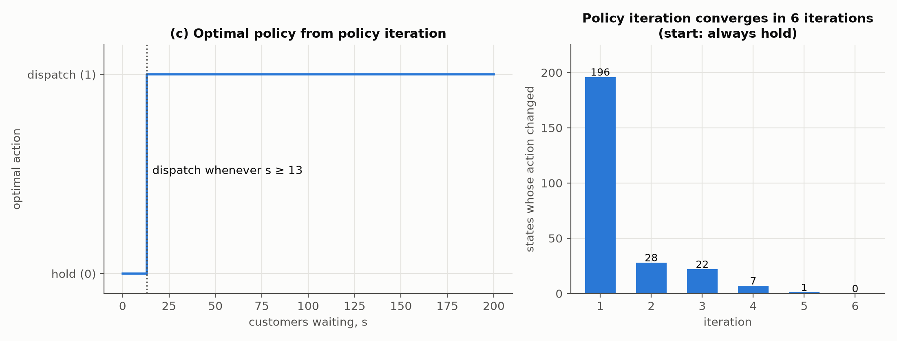

*Figure 3. Optimal action against customers waiting, and the number of states whose action changes at each policy-iteration step. The threshold is 13. Policy iteration from "always hold" is done in 6 iterations (196, 28, 22, 7, 1, 0 states changed).*

### Edge cases

The interesting edges are properties of this cost, not generic "empty input" checks.

- **The cap.** Caps 30, 200, 300, and 400 give the same value and the same policy on the states they share (max difference under `1e-12`). Cap 10 does not. Overflow customers vanish for free, so the problem becomes artificially cheap: `V(0) = 356.04` instead of 576.67, and the optimal policy **never dispatches**. That is a modeling artifact, and the test `cap_10_artifact` checks both the value and the empty dispatch set.
- **When the holding cost is charged.** Charging `ch` on the post-arrival queue instead of the post-decision queue adds a constant. Measured `V(0)` goes from 576.67 to 696.67 (difference 120). The threshold stays 13. An additive constant that does not depend on the action cannot change the policy. The timing ambiguity in the problem statement is therefore harmless for the decision.
- **Ties.** At `s = 0` with `cf = 0`, dispatch and hold tie and the code holds. The test `limit_cf_zero` requires dispatch for every `s ≥ 1` and hold at 0.
- **Boundary transitions.** Holding at 198 puts mass 0.2 on 199 and 0.8 on 200. Holding at 199 or 200 puts mass 1 on 200. Dispatching from 200 goes to `{186,…,190}`. These are checked exactly.
- **Convexity.** `V` is **not** convex. The minimum second difference is −3.778. That prediction was not held, and it should not have been assumed: the value is a min over actions of functions that need not stay convex. This is the one Part 1 prediction that failed.

### How we know it is correct

Re-run this session: 38 checks, 0 exact failures, 1 prediction not held (convexity), and `pytest` 29 passed. The full table is `shuttle/validation_results.md`. The checks that pin the algorithm down, rather than the file format:

- One- and two-stage values match a hand calculation (`1e-13`).
- The 12-step deterministic enumeration matches backward induction (`1e-13`).
- Value iteration and policy iteration agree to `8e-11` and return the same policy. Policy iteration from always-hold, always-dispatch, and a random start all reach that policy.
- Policy iteration is monotone: the value never increases (costs are minimized).
- A Monte Carlo of the optimal policy from `s = 0` gives 576.56 ± 0.16 against `V* = 576.67` (`z = −0.68`).
- The optimal policy beats "never dispatch" (`V(0) = 2203.9`) and "always dispatch" (`V(0) = 2000`).
- With `ch = 0` the value is 0 and the policy never dispatches. With `γ = 0` it also never dispatches, because one dispatch saves at most `ch · 15 = 30 < 100`.
- Slopes `dV/ds` at `s = 50, 100, 199` are 10.6, 16.9, 24.9, all below `ch / (1 − γ) = 40`.

### Discussion

The threshold is 13 because a dispatch costs 100 and clears the queue, while holding costs `2s` now and leaves a larger state. Below 13 the holding cost plus the discounted future is still cheaper than paying 100. States 13, 14, and 15 all dispatch, so `V` is flat there: they pay the same 100 and face the same arrival distribution. The finite horizon `T = 500` is not an approximation we have to apologize for. `γ^500` is about `7e-12`, and the measured gap to the infinite-horizon value is `4.9e-9`.

---

## Part 2 — REINFORCE

### Estimator

The implemented loss, averaged over the episodes in a batch and summed over time inside an episode, is

```
L = −(1/B) Σ_episodes Σ_t  w_t · log π(a_t | s_t) · (G_t − b_t)
```

`G_t` is the reward-to-go, computed backward: `G_t = r_t + γ G_{t+1}`. Part 2 uses `b_t = 0`.

**`w_t = 1` in every primary run** (`--gamma_weight off`). The gradient of `E[Σ_t γ^t r_t]` would multiply the step-`t` term by `γ^t`. At `γ = 0.95` that factor is about 0.006 by step 100, so the end of a long CartPole episode would barely move the weights. The unweighted estimator is the usual basic REINFORCE. It optimizes a slightly different objective (it reweights the state distribution). This is not hidden: T-R2 shows the two gradients differ, and config C3 turns the `γ^t` weight on.

On Pong, returns **reset when a point is scored**. A point is `r = ±1` and ends a rally. Without the reset, a later point leaks into earlier rallies. On the rewards `[0, 0, −1, 0, 0, 1]` with `γ = 0.99`, the reset gives `G[2] = −1`. Without it, `G[2] ≈ −0.030`. The flag is `--pong_reset_at_point`, default on.

Returns are **not** standardized in any primary run. Standardization is a baseline, and it would make Part 2 and Part 3 incomparable. The flag exists and is labeled if it is used.

The last policy layer is initialized at `0.01` times the default weights, bias 0, so the initial policy is essentially uniform (entropy `ln 2 ≈ 0.693`). Actions are drawn with `torch.multinomial(..., generator=)`, because this torch build's `Categorical.sample` does not accept a generator. That is what makes a seed replay.

Adam is the optimizer. Its first update moves every parameter with a nonzero gradient by exactly the learning rate (measured: `±0.010000` and `0` on a zero gradient). A baseline that shrinks the gradient therefore does **not** take a larger Adam step. Any gain shows up as a less noisy curve, not as a bigger update.

### CartPole-v1

`γ = 0.95`, Adam learning rate **0.01** as specified, **one episode per update**, MLP `4 → 128 → 2`, 2000 episodes, five seeds (0–4). The episode return is plain Monte Carlo. There is no bootstrap at the 500-step truncation, so the estimator is unbiased for the truncated-horizon objective and `V` near the cap is slightly low. That limitation is stated rather than patched. The environment is `CartPole-v1` with default settings. Each episode records whether it ended because `|x| > 2.4`, because `|θ| > 12°`, or because of the time limit.

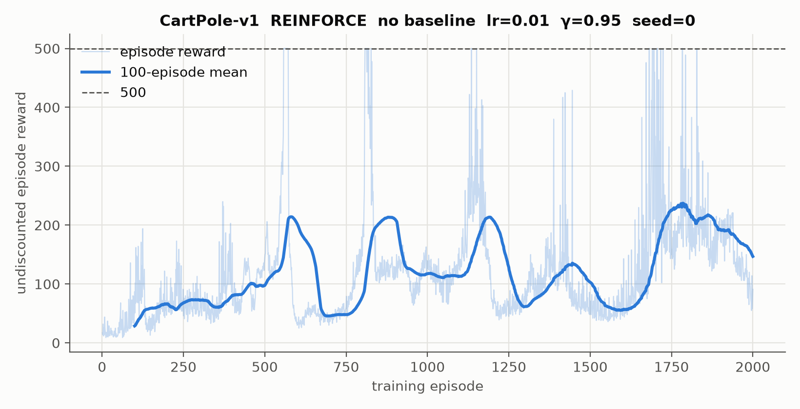

*Figure 4. CartPole, no baseline, seed 0, lr 0.01, γ = 0.95. Thin line: undiscounted episode return. Bold line: trailing 100-episode mean, drawn only from episode 100. Dashed line: the 500-step cap. Seed 0's moving average ends at 147, well above the random-policy mean of about 22, and well short of the cap.*

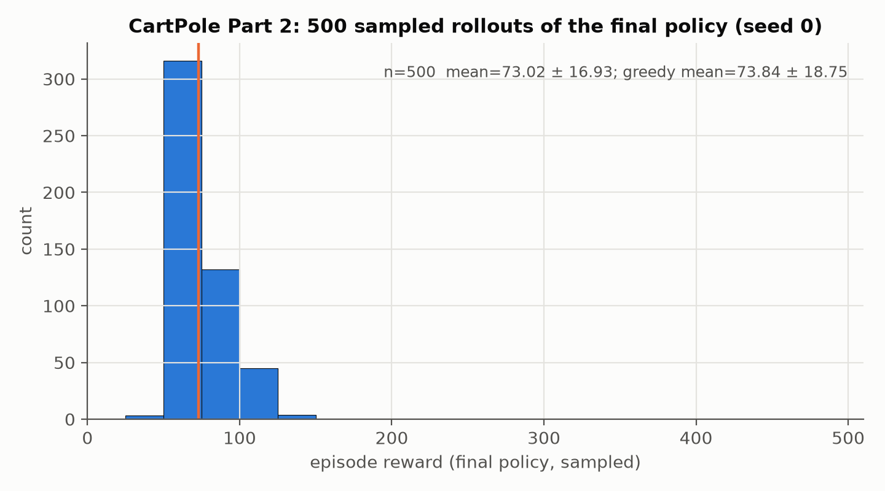

*Figure 5. 500 sampled rollouts of the **final** seed-0 policy (evaluation seeds start at 10000, not the training seed). Mean 73.0, standard deviation 16.9, n = 500. Greedy rollouts: 73.8 ± 18.8. There is no spike at 500: this final policy never survives the time limit. Every one of the 500 episodes ends by the angle limit.*

The training moving average and the final-policy evaluation are not the same number, and the report uses the evaluation. Seed 0's training MA100 is 147; the 500-episode evaluation of the saved final weights is 73. Five checkpoints from the last 20% of that run, 50 episodes each, scored 60, 267, 196, 199, and 77. They differ by more than 100. The final save is one draw from a noisy late policy. That is why the rule was fixed before looking: evaluate the final weights, and publish the spread.

| seed | training MA100 | 500-ep mean ± std (sampled) | greedy mean ± std | how episodes ended |
|---|---|---|---|---|
| 0 | 146.8 | 73.0 ± 16.9 | 73.8 ± 18.8 | angle 100% |
| 1 | 9.3 | 9.3 ± 0.7 | 9.4 ± 0.7 | angle 100% |
| 2 | 181.0 | 293.5 ± 85.7 | 340.7 ± 108.0 | x-limit 34%, angle 57%, time-limit 9% |
| 3 | 92.4 | 127.8 ± 12.0 | 128.6 ± 12.8 | angle 100% |
| 4 | 9.3 | 9.3 ± 0.7 | 9.4 ± 0.7 | angle 100% |

Across the five seeds the training MA100 averages **88**, which is under the plan's fallback line of 100. Two seeds collapsed to episodes of length about 9, worse than the random policy (about 22). The lr = 0.01, one-episode-per-update run is still the primary Part 2 result. The fallbacks are labeled and are not substituted for it:

- **C7**, 8 episodes per update, same lr 0.01, seeds 0–2. Final training MA100: 351, 192, 139. None collapsed during training. The saved final policies evaluate at 182 ± 22, 165 ± 10, and 157 ± 9, and essentially every episode ends by the cart leaving the track. The training curve overstates the policy that was saved.
- **C8**, lr 0.003, one episode per update, seeds 0–2. Final MA100: 146, 152, 143. Final-policy evaluations: 133 ± 10, 153 ± 9, 185 ± 27. None reached the cap.
- **C4**, lr 0.001, seeds 0–2. Final MA100: 485, 221, 132. Final-policy evaluations: 476 ± 53, 195 ± 28, 149 ± 22. Seed 0 is the only one of these three that mostly hits the time limit (68% sampled, 99% greedy). The smaller step is more reliable than 0.01 on this problem, and it still has a seed that never reaches the cap.

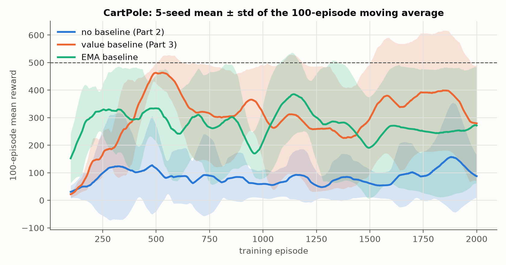

*Figure 6. Mean ± one standard deviation, across five seeds, of the 100-episode moving average. The no-baseline mean stays lower (88 ± 78). The value and EMA bands are wider (280 ± 211 and 272 ± 209), because those runs include both a collapse to length 9 and runs that sit on the cap. The band crosses the dashed line at 500 because the standard deviation does; a single episode cannot score above 500.*

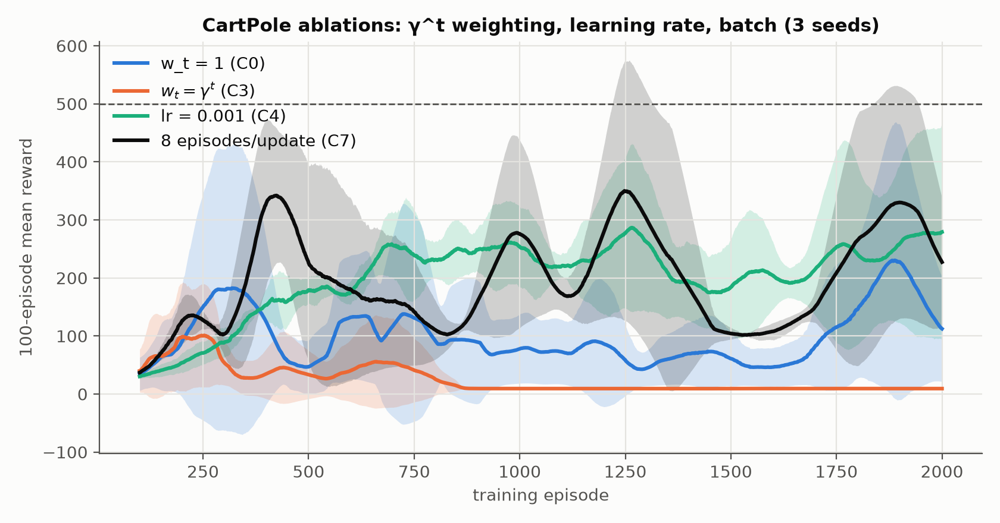

*Figure 7. Three-seed ablations. `w_t = γ^t` (C3) does not learn: every seed ends at MA100 ≈ 9.3. lr 0.001 (C4) and 8 episodes per update (C7) both beat the primary lr-0.01 curve.*

**`γ^t` weighting removed the learning signal.** C3, three seeds, 2000 episodes, same lr 0.01: final MA100 is 9.3, 9.3, 9.5, and the 500-episode evaluations sit on that floor. This is the behavior T-R2 predicts. With `γ = 0.95` the weight at step 100 is already negligible, and CartPole's useful gradient often arrives late, when the pole is actually falling.

**Negating the reward makes the agent fail fast.** C5, three seeds, 300 episodes, rewards multiplied by −1. Mean length of the last 50 episodes: 9.3, 9.2, 9.4, all under the predicted ceiling of 15 (a random policy lasts about 22). The sign of the advantage is doing what it should.

**`γ = 0` did not stay at the random policy.** T-C8 says the expected gradient is zero, because `G_t = 1` at every step and the score function has mean zero, so three seeds of 1000 episodes should keep a mean length near 22. They did not. Last-100 mean lengths are 9.3, 9.5, and 9.4, and the final entropy is about 0.001. One episode is one noisy sample of a mean-zero gradient, and Adam at lr 0.01 still takes a step of size about 0.01. A thousand of those steps collapsed the policy onto a short angle failure. The expectation is zero; this optimizer on one-episode batches is not. The optional sweep over `γ ∈ {0.5, 0.8, 0.99}` was not run.

**Termination causes.** The guess was that `γ = 0.95` leaves a short horizon and some failures by the cart drifting out (`|x| > 2.4`). On the headline seed that is false: all 500 evaluation episodes end by angle. On seed 2, which actually learned, 34% end by the cart position, 57% by angle, and 9% hit the time limit. The drift shows up only once the policy is good enough to survive the early angle failures. The histogram for seed 0 is unimodal around 70, not bimodal, and it has no mass at 500.

### Pong-v5

The environment is `ALE/Pong-v5` with the defaults: frameskip 4, sticky-action probability 0.25, six actions. The network chooses only between index 0 and 1, sent to the emulator as actions 2 (RIGHT) and 3 (LEFT). The state is the difference of two preprocessed 80×80 frames, stored as int8 in `{−1, 0, 1}`. The first difference of an episode is all zeros, because there is no previous frame. `preprocess` is the function in the assignment, applied to a **copy**. The original slices are views and would erase the caller's frame; T-P3 checks that the input is unchanged.

Actors are a spawn pool. Each worker builds its own environment, sets `CUDA_VISIBLE_DEVICES=""`, and plays one full episode with a frozen weight vector. Gymnasium's vector environments are not used: their auto-reset can splice the next episode onto the return. The learner recomputes `log π` on the GPU with those same weights, so the update is on-policy. T-P6 measured the gap between the actor's log-probability and the learner's recomputation at `0` on a 945-step episode.

The architecture is the Karpathy MLP, `6400 → 200 → 2`. The batch is 16 episodes, all played with the same weights. Sixteen is also the worker count: the pool size is `min(workers, episodes per update)`, so a batch of 16 cannot feed 32 actors. The benchmark's fastest setting was 32 workers (14372 env-steps/s). Twenty-four workers reached only 88.5% of that, outside the 10% band, but 32 workers would require a batch of at least 32. The pre-registered batch stays 16. Two jobs at 16 workers use the 32-worker cap and no more.

**Learning-rate sweep** (baseline none, 2000 episodes, seed 0, batch 16). The selection metric, fixed beforehand, is the final training MA100.

| lr | final MA100 | entropy at the end | rally length near the end |
|---|---|---|---|
| **0.01** | **−0.98** | 0.044 | ~3400 |
| 0.001 | −17.27 | 0.45 | ~1900 |
| 0.0003 | −20.09 | 0.69 | ~1100 |
| 0.0001 | −20.40 | 0.69 | ~1000 |

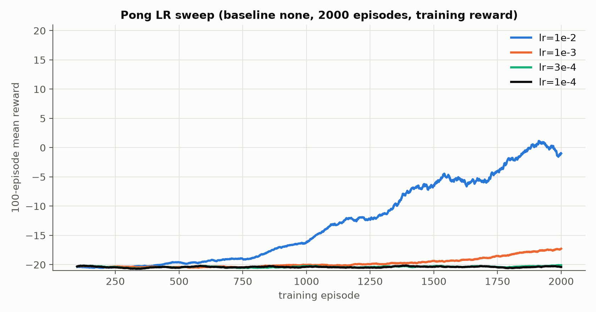

*Figure 8. 100-episode mean of the training reward for the four learning rates, each stopped at 2000 episodes. Only lr = 0.01 leaves the random-agent floor inside that window. It is also the learning rate the assignment asked for, so the primary full runs do not change it. The curve at 0.01 reaches about +0.8 and ends at −1.0. lr 0.001 is still near −17 here. That ranking does not survive the 3-hour runs below: the sweep horizon was too short.*

A random agent scores about −20.7, and the standard error of a 100-episode mean is about 0.1, so a rise of 0.3 is the smallest change worth calling learning. lr = 0.01 rises by about 19 points and triples the rally length. The policy also becomes very peaked (entropy 0.04, against a maximum of 0.69). The action margin stays near one half (`frac` of index 0 ≈ 0.45), so it has not collapsed onto a single button; it has collapsed onto a confident choice in each state. The two smaller rates never leave entropy 0.69 and never leave −20. lr = 0.001 is in between: MA100 −17.3, entropy still 0.45, rallies about 1900.

The smoke test at lr 0.001 for 200 episodes, run before the sweep, stayed finite, kept entropy at 0.693, and kept the action fraction at 0.50. That only checks that the loop is not diverging. Inside the 2000-episode window, 0.01 is the rate that learns, which is why the primary runs stay at 0.01. The extended runs later in this section show that window was too short for 0.001.

The full Part 2 run is seed 0, lr 0.01, batch 16, no baseline, no return standardization. It stopped at episode 5232, after 986 seconds, because the 100-episode mean had moved only from −2.29 to −2.08 across 3000 episodes. That rule looks at the two endpoints. Inside the window the curve still swung: the moving average peaked at **+2.65** at episode 3092 and finished at **−2.08**.

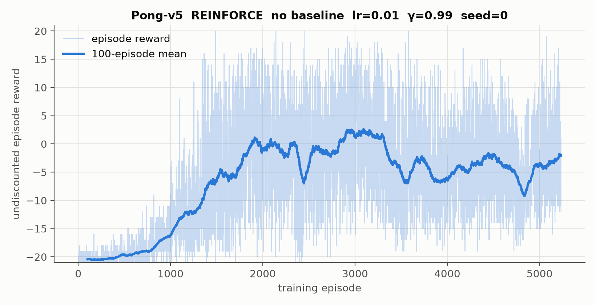

*Figure 9. Pong, no baseline, seed 0, lr 0.01, γ = 0.99. The moving average leaves the random-agent floor near −21, spends a few thousand episodes around zero, and is stopped at −2.1. Individual episodes still cover almost the whole score range.*

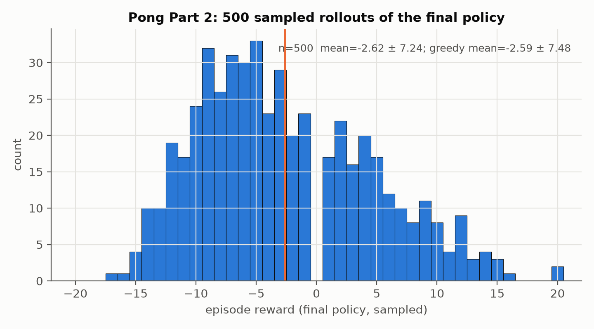

*Figure 10. 500 sampled rollouts of the final Part 2 policy (evaluation seeds from 10000). Mean −2.62, standard deviation 7.24, n = 500, range −17 to +20. Greedy rollouts: −2.59 ± 7.48, range −21 to +20. The mass sits a little below zero. A few games reach +20, and the policy is not a solved player.*

Five checkpoints from the last 20% of training, 50 episodes each, scored −3.80, −3.68, −3.04, −3.16, and −3.78. They agree with each other to about one point. The final-policy lottery that showed up on CartPole does not show up here. Entropy at the end of training was 0.023, so the policy is confident, and the fraction of index-0 actions stayed near 0.45, so it did not lock onto one button.

### Extended run (lr 0.001, no baseline)

This is not the Part 2 result. The Part 2 result is the lr 0.01 run above. lr 0.001 was chosen after that run and after the 2000-episode sweep were already finished. The moving-average early-stop was off. The episode ceiling was 1,000,000, so the run stopped when `run_meta.json` recorded 10801.9 seconds (3.00 hours). It played 42,128 episodes. Entropy at the last update was 0.055.

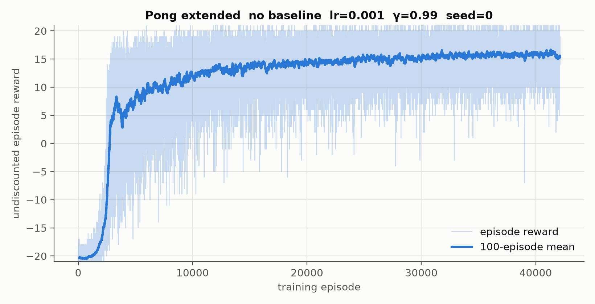

*Figure 11. Extended run, no baseline, seed 0, lr 0.001, γ = 0.99, early-stop off. The 100-episode mean leaves −21 later than the lr 0.01 curve and is still near +15.6 when the 3-hour clock stops it. The primary lr 0.01 run had already stopped at −2.08.*

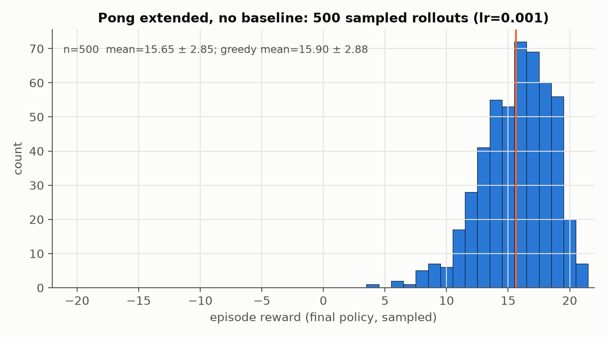

*Figure 12. 500 sampled rollouts of that final policy, evaluation seed 10000, the same seed as the primary runs. Mean 15.65, standard deviation 2.85, n = 500, range 4 to 21. Greedy: 15.90 ± 2.88. Five checkpoints from the last 20% of training, 50 episodes each, scored 16.5, 16.1, 16.2, 16.4, and 15.3.*

The 2000-episode sweep favored lr 0.01. At that horizon lr 0.001 sat at −17.27. After about 40,000 episodes the order reversed: this run's final moving average is +15.56 and its 500-episode mean is +15.65, against −2.08 and −2.62 for the primary no-baseline run. The sweep horizon was too short.

The clocks are not the same experiment. This run trained for 3.00 hours. The primary no-baseline run's `run_meta.json` clock is 987 seconds, 0.27 hours, about 16 minutes. The comparison mixes learning rate and training length. The four-run table, with the value-baseline pair, is in the Part 3 extended-run section.

### How we know the estimator and the Pong pipeline work

Exact checks that passed, with the measured error:

- **T-R1.** `[1,1,1]` at `γ = 0.5` gives `[1.75, 1.5, 1.0]`, not the forward-order `[1, 1.5, 1.75]`. The same rewards at `γ = 0.95` give `[2.8525, 1.95, 1.0]`. The Pong reset on `[0,0,−1,0,0,1]` matches the hand values to the printed precision, and the no-reset `G[2]` is −0.0297.
- **T-R2.** On a 2-step, 3-state softmax MDP, 200,000 trajectories. With `w_t = γ^t`, every component of the sample mean is within 4 standard errors of the autograd gradient (max `|z| = 1.13`). With `w_t = 1`, the sample matches the enumerated expectation of *that* estimator (max `|z| = 0.72`) and differs from the true gradient by 147 standard errors in one component. At `γ = 0.5` the unweighted step-2 term is off by a factor of two.
- **T-R3.** Softmax bandit, `θ = 0`, rewards `(1, 0)`. Sample mean of the gradient at N = 200,000: `(0.2509, −0.2509)`, against the closed form `(0.25, −0.25)`, `|z| = 1.56`.
- **T-C4.** Two runs with the same seed produce the same first episode. Two fresh agents after three updates have bit-identical CPU weights. Omitting `zero_grad` changes a parameter from 0.60 to 0.80, so the test can fail.
- **T-P1, T-P2, T-P3.** Over 1000 steps every env action is in `{2, 3}`. Forcing action 2 for 30 steps then action 3 for 60 moves the right paddle 28 px one way and 78 px the other, in opposite directions. `preprocess` does not modify its input. The first frame difference is identically zero. Later differences lie in `{−1, 0, 1}` and are nonzero on 96% of steps after step 20 in the checked episode.
- **T-P6, T-P7, T-P10.** Learner and actor log-probabilities match to `0`. On a real episode, `G_t = r_t` at every scoring step (21 points checked). Killing a run after 3 episodes and resuming lands on episode 5 with no duplicated CSV rows and with weights that are not the initialization.

Predictions that were **not** held:

- **T-P5.** An untrained net, 20 episodes: rewards included a −18, so they are not all inside `[−21, −19]`. The mean was −20.40, which *is* inside `[−21, −19.8]`. One sticky-action episode scored a point. The published "random ≈ −20.7, every game in [−21, −19]" description is slightly too tight for 20 episodes. Learning is still only claimed when the 100-episode mean rises by more than about 0.3 and stays there. lr = 0.01 does; lr = 0.0001 does not (final MA100 −20.40).
- **T-P9, first attempt.** A chase of the ball's current row scored −21 on every episode. The mask was zeroing every column from 64 on, which is where the ball is when the paddle has to hit it, and one frameskipped action moves the paddle by about 11 rows, so the sign flipped every step. The replacement predicts the row at the paddle, reflecting off the walls, and holds still inside a 5-pixel band. On the deterministic environment that scores **+9** on each of 10 episodes. The frames were fine; the controller was not. Training does not use this controller.

The first 10 CartPole steps of a fixed seed (probabilities are 0.500 to three digits, which is the uniform initialization; `G` falls by about `γ` each step because every reward is 1):

| t | x | dx | theta | dtheta | P(a=0) | a | r | G | log π |
|---|---|---|---|---|---|---|---|---|---|
| 0 | 0.027 | −0.006 | 0.036 | 0.020 | 0.500 | 0 | 1 | 13.189 | −0.693 |
| 1 | 0.027 | −0.202 | 0.036 | 0.324 | 0.500 | 1 | 1 | 12.830 | −0.694 |
| 2 | 0.023 | −0.007 | 0.043 | 0.042 | 0.500 | 1 | 1 | 12.453 | −0.694 |
| 3 | 0.023 | 0.187 | 0.044 | −0.236 | 0.500 | 1 | 1 | 12.056 | −0.693 |
| 4 | 0.027 | 0.382 | 0.039 | −0.515 | 0.500 | 0 | 1 | 11.638 | −0.693 |
| 5 | 0.034 | 0.186 | 0.029 | −0.210 | 0.500 | 0 | 1 | 11.197 | −0.693 |
| 6 | 0.038 | −0.009 | 0.024 | 0.091 | 0.500 | 0 | 1 | 10.734 | −0.692 |
| 7 | 0.038 | −0.205 | 0.026 | 0.391 | 0.501 | 0 | 1 | 10.247 | −0.692 |
| 8 | 0.034 | −0.400 | 0.034 | 0.692 | 0.501 | 0 | 1 | 9.733 | −0.692 |
| 9 | 0.026 | −0.596 | 0.048 | 0.995 | 0.501 | 1 | 1 | 9.193 | −0.695 |

The full row, including the raw arrays, is `results/validation/cartpole_10step_trace.json`.

---

## Part 3 — Baselines

### What was implemented

Two baselines, both action-independent, so neither changes the mean of the gradient in expectation.

1. **Primary: a learned state-value baseline.** A second network with the same trunk and one scalar output, its own Adam at learning rate `1e-3` (both games). It regresses onto the same `G_t` the policy uses. The advantage is `G_t − V_φ(s_t)` with `V` detached inside the loss. The value step happens *after* the policy step. On Pong the value pass is one epoch of minibatches of 4096. Advantages are not standardized.
2. **Secondary: a constant EMA.** `b ← 0.9 b + 0.1 · mean(G)` using only previous batches. The batch being updated still sees the old `b`. The first batch sees `b = 0`. Using the current episode's own returns would make `b` depend on the actions just sampled.

### CartPole

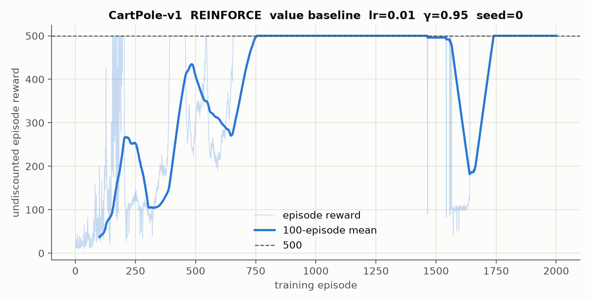

*Figure 13. Value baseline, seed 0, same lr 0.01 and γ = 0.95 as Part 2. The moving average first reaches the cap near episode 744, falls to about 182 around episode 1640, and is back at 500 at the end. The final policy, not the dip, is what the histogram evaluates.*

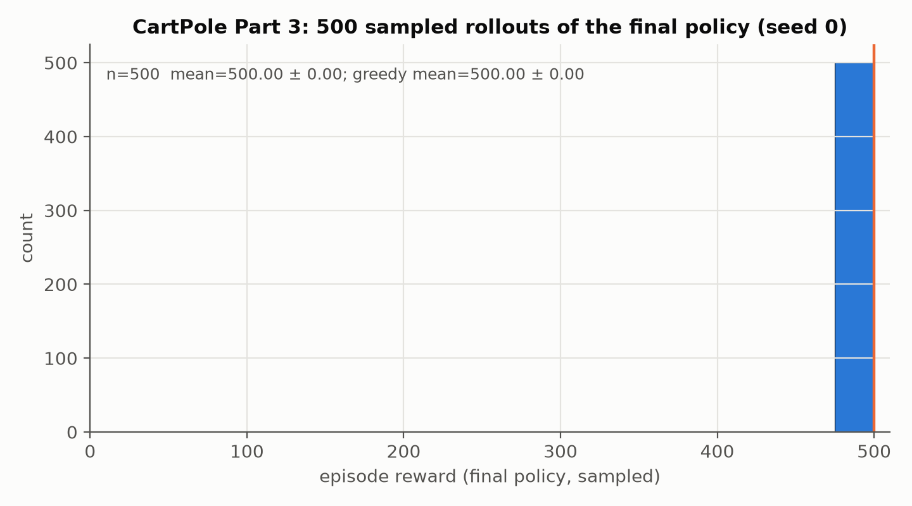

*Figure 14. All 500 sampled rollouts of the final seed-0 value-baseline policy score 500 (std 0). Greedy rollouts are the same. Every episode ends at the time limit. This is the truncation spike the histogram is supposed to show, and it is the entire distribution.*

| config | training MA100 by seed | 500-ep sampled means |
|---|---|---|
| C0, no baseline | 146.8, 9.3, 181.0, 92.4, 9.3 | 73.0, 9.3, 293.5, 127.8, 9.3 |
| C1, value baseline | 500, 161.2, 245.6, 9.3, 481.5 | 500, 27.6, 500, 9.3, 490.3 |
| C2, EMA | 469.7, 162.6, 9.5, 500, 217.2 | 452.7, 209.4, 9.3, 500.0, 96.8 |

Seed 0 is the figure. Across seeds the value baseline is better on average and still not magic: seed 3 collapses to length 9, the same failure mode as Part 2, and seed 1's training MA100 is 161 while the **final** policy evaluates at 27.6. The EMA seed-0 evaluation is 452.7 ± 130.8 sampled and 491.9 ± 56.8 greedy, with 88% of episodes hitting the time limit. Seed 1 of the EMA run never hits the time limit: all 500 evaluation episodes end by the cart position, mean 209 ± 14. Seed 4 evaluates at 97 ± 16, all angle.

The comparison that is fair to report, using the 500-episode means: seed 0 is 73 with no baseline and 500 with the value baseline. Across five seeds the means are 103 ± 118 (no baseline), 305 ± 262 (value), and 254 ± 216 (EMA). The value baseline did not reduce the across-seed standard deviation. Both Part 2 and Part 3 have a seed that never leaves the floor, so T-B7's hope of a tighter seed distribution is not what these five seeds show. The standard deviations are of the five seed-means, not of the 500 episodes inside one seed.

### The variance evidence (T-B5)

The policy was frozen at three checkpoints of C0 seed 0 (episode 200, episode 1000, and the final weights). One thousand fresh episodes were split into A and B, 500 each. A value network was fit on A, and a constant baseline was the mean return on A. On B, the same trajectories produced the policy gradient under `b = 0`, `b = const`, and `b = V`.

A 40-epoch fit left `R²` negative (about −0.05 to −0.30). That fit had not moved. Adam steps are about the size of the learning rate (T-R4), and `1e-3` for 40 steps cannot lift a value head from 0 up to returns near 15. The reported fit keeps lr `1e-3` and runs until the training MSE flattens or 4000 epochs pass. That is the "many epochs" the experiment asked for.

| checkpoint | `R²` on B | `tr(Cov)` const / `b=0` | `tr(Cov)` V / `b=0` | cos(`b=0`, const) | cos(`b=0`, V) |
|---|---|---|---|---|---|
| episode 200 | 0.946 | 0.182 | 0.012 | 0.973 | 0.973 |
| episode 1000 | 0.989 | 0.172 | 0.002 | 0.614 | 0.333 |
| final | 0.968 | 0.194 | 0.011 | 0.987 | 0.989 |

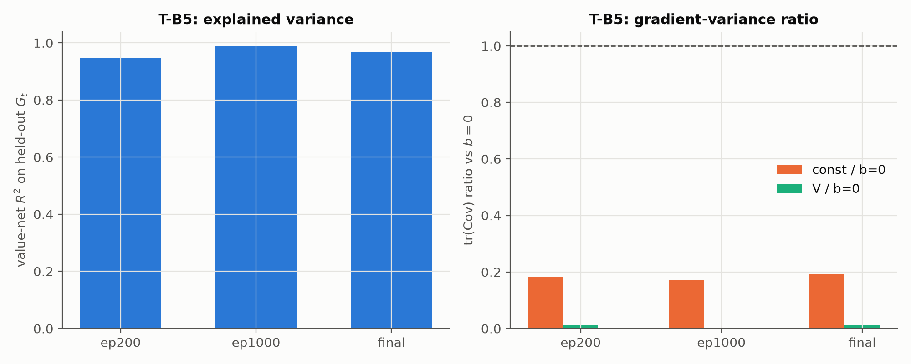

*Figure 15. Left: the value network explains almost all of the held-out return variance once it is actually fit. Right: both baselines cut the trace of the gradient covariance; the state-value baseline cuts it by roughly 100×. The dashed line is "no reduction."*

The constant baseline is worth about a 5× variance cut and stays aligned with the uncentered gradient except at the episode-1000 checkpoint, where the cosine falls to 0.61. The value baseline's cosine at that same checkpoint is **0.33**, not 1. The mean gradient there is small relative to the noise (the no-baseline trace is five times larger than at the other two checkpoints), so the cosine of two noisy means is not a stable "the estimator is unbiased" certificate at that one checkpoint. At episode 200 and at the final weights the cosines are 0.97 and 0.99. The variance ratios are below 1 at every checkpoint. `R²` is above 0.5 at every checkpoint, including the final one (0.97).

The toy-MDP version of the same claim (T-B1, N = 200,000, every reward shifted by +10) is exact: `b = 0`, `b = J`, and `b = V^π` all match the true gradient within 1 standard error, and the covariance traces are 139.6, 3.58, and 0.11. The optimal constant baseline of a 2-action bandit equals `J` when `π = (1/2, 1/2)`, weights the rarer action 9× when `π = (0.9, 0.1)`, and has the smallest variance of `{b*, J, 0}`.

Detaching works (T-B3). With the value head clamped at 0, the Part 3 gradient equals the Part 2 gradient exactly (max abs difference 0). After the policy backward, every value parameter has a null or zero gradient. The value-loss backward does not change the policy gradient.

### Pong with a baseline

The Part 3 Pong run uses the same lr 0.01 and the same batch of 16, plus the learned value baseline. Standardization stayed off, because Part 2 already left −21 without it. About 10 minutes in, this run was holding 41 GB on the 48 GB card. It was stopped at episode 2752 and resumed from that checkpoint after the value update was changed to drop each minibatch. The 16 episodes that had been logged but not checkpointed were collected again. The resumed run stopped at episode 7488 because the moving average had moved only from 10.37 to 10.65 over 3000 episodes. The peak was **+12.68** at episode 7099. The final training MA100 is **+10.65**.

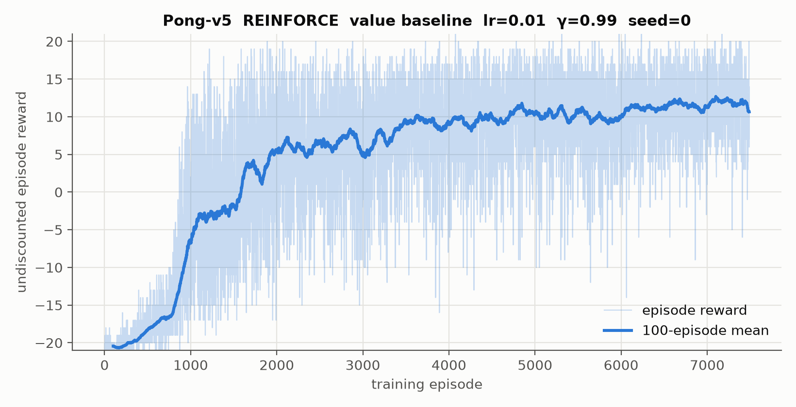

*Figure 16. Pong, value baseline, seed 0, lr 0.01, γ = 0.99. The moving average crosses zero near episode 1500 and levels off near +11. That is about 13 points above the Part 2 run, which leveled off near −2.*

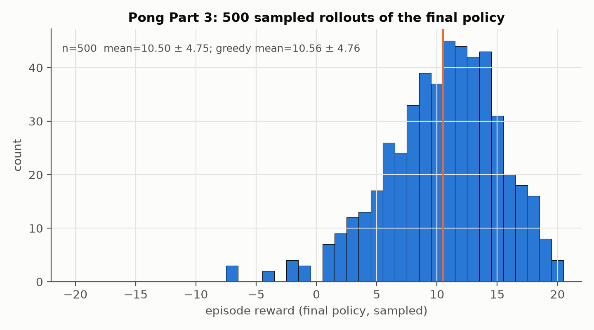

*Figure 17. 500 sampled rollouts of the final value-baseline policy. Mean 10.50, standard deviation 4.75, n = 500, range −7 to +20. Greedy: 10.56 ± 4.76. Almost all of the mass is positive. A handful of games still lose.*

Five late checkpoints, 50 episodes each, scored 11.7, 10.7, 10.3, 10.9, and 11.4. Same picture as Part 2: the late policies agree, and the final save is not a lucky outlier.

### Extended run (lr 0.001, value baseline)

Same departure from the spec as the extended Part 2 run: lr 0.001, early-stop off, 3-hour cap, seed 0, 16 workers, run at the same time as that no-baseline job. It was chosen after the primary results were in. `run_meta.json` records 10804.8 seconds and 39,232 episodes. The last-update entropy was 0.056.

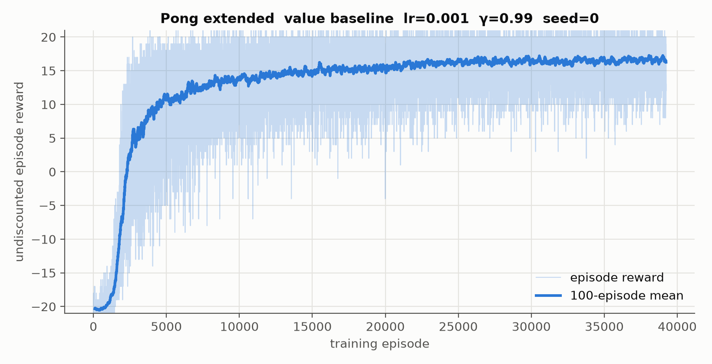

*Figure 18. Extended run, value baseline, seed 0, lr 0.001. The moving average ends at +16.26. The primary value-baseline run, at lr 0.01, ended at +10.65.*

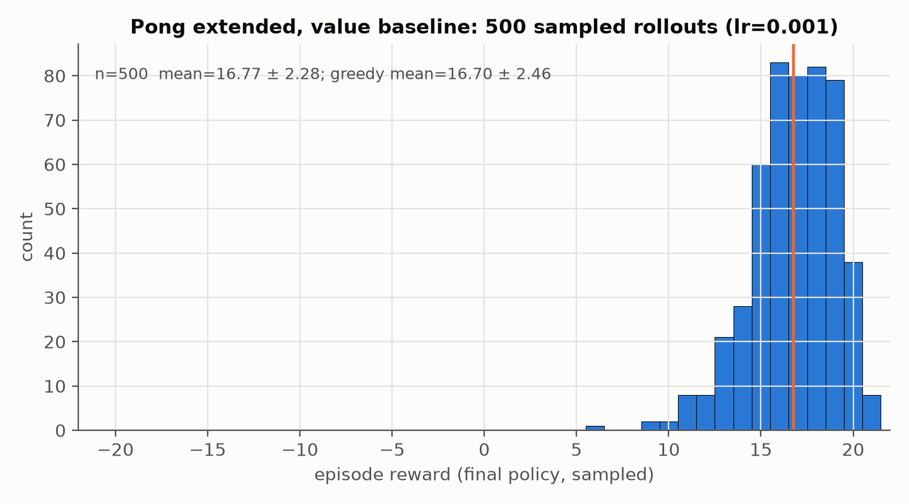

*Figure 19. 500 sampled rollouts, evaluation seed 10000. Mean 16.77, standard deviation 2.28, n = 500, range 6 to 21. Greedy: 16.70 ± 2.46. Five late checkpoints, 50 episodes each, scored 16.8, 16.9, 17.2, 17.4, and 16.7.*

| run | episodes | wall-clock hours | final MA100 | entropy at the end | 500-ep sampled |
|---|---|---|---|---|---|
| lr 0.01, no baseline | 5232 | 0.27 | −2.08 | 0.023 | −2.62 ± 7.24 |
| lr 0.01, value baseline | 7488 | 0.33 | +10.65 | 0.020 | +10.50 ± 4.75 |
| lr 0.001, no baseline | 42128 | 3.00 | +15.56 | 0.055 | +15.65 ± 2.85 |
| lr 0.001, value baseline | 39232 | 3.00 | +16.26 | 0.056 | +16.77 ± 2.28 |

Hours are `run_meta.json` seconds divided by 3600. The lr 0.01 value-baseline cell is the resumed process only (1189.7 seconds). The killed prefix, before the memory fix, was about 10 minutes and is not in that cell. Moving averages and the 500-episode means are recomputed from `episode_rewards.csv` and `eval_sampled.csv`. Entropy is the last row of `curve.csv`.

On these files the lr 0.001 policies score higher than both primary runs, in the training moving average and in the 500-episode evaluation. The 2000-episode sweep had the opposite order, because lr 0.001 was still near −17 when that sweep stopped. The longer runs also trained about ten times longer than the clocks in the table (3.00 hours against 0.27 and 0.33 hours), so learning rate and training length are mixed. lr 0.001 was chosen after seeing the lr 0.01 results.

The baseline's advantage at lr 0.001 is +16.26 against +15.56 on the training MA100, under one point, from one seed each. The evaluation gap is about one point (16.77 against 15.65). That is not evidence that the baseline helped or that it did not.

| run | episodes | training MA100 | 500-ep sampled | greedy |
|---|---|---|---|---|
| P0, no baseline | 5232 | −2.08 (peak +2.65) | −2.62 ± 7.24 | −2.59 ± 7.48 |
| P1, value baseline | 7488 | +10.65 (peak +12.68) | +10.50 ± 4.75 | +10.56 ± 4.76 |
| P2, EMA baseline | 6016 | +4.10 (peak +7.61) | +5.19 ± 7.46 | +5.01 ± 6.89 |

On this seed, at lr 0.01, the value baseline is worth about 13 points over no baseline, and the EMA sits between them. The value-baseline evaluation matches its training moving average. It is one seed. The CartPole matrix is the evidence that a single seed can flatter either algorithm. Pong was pre-registered at one seed because of the wall clock, and that limit is what this table is.

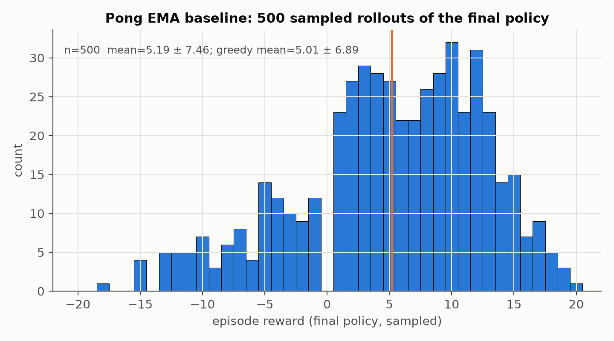

*Figure 20. 500 sampled rollouts of the EMA policy. Mean 5.19 ± 7.46, n = 500, range −18 to +20. The distribution is wide and has weight on both sides of zero, unlike the value-baseline histogram, which is mostly above zero.*

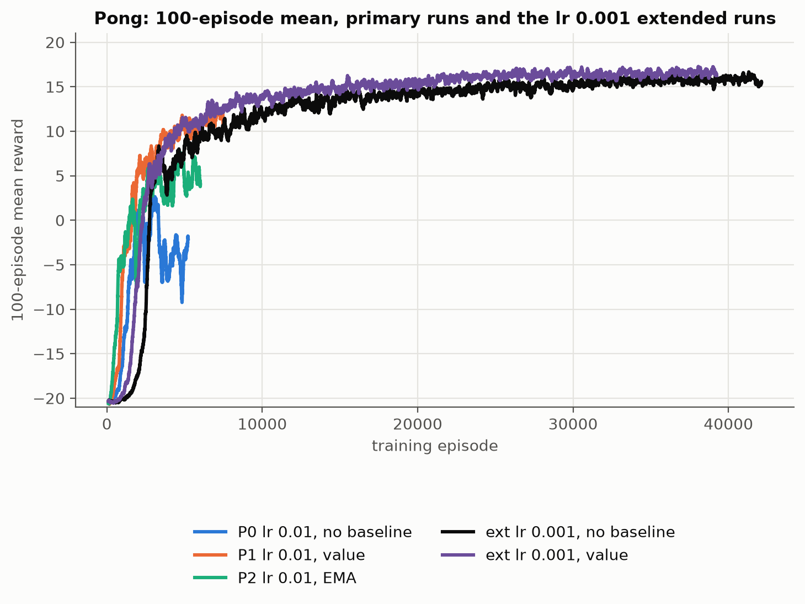

*Figure 21. 100-episode mean of every Pong run. The lr 0.01 runs stop within the first few thousand episodes: no baseline near −2, EMA near +4, value baseline near +11. The two lr 0.001 runs continue to about 40,000 episodes and finish near +16. They also trained for 3 hours rather than about 16–20 minutes, so the picture mixes learning rate and training length.*

The EMA late checkpoints, 50 episodes each, scored 7.7, 4.6, 6.5, 8.9, and 6.2. That is a wider band than Part 2 or the value baseline (those stayed within about one point) and still nothing like the CartPole spread of more than 100. P2 stopped at episode 6016 because the moving average had moved from 4.11 to 4.10 over 3000 episodes.

---

## Edge cases across the three parts

| what can go wrong | what we did | test | measured |
|---|---|---|---|
| Cap makes customers free | solved caps 10, 30, 200, 300, 400 | `cap_10_artifact` | cap 10: V(0)=356, never dispatch; larger caps agree |
| Holding-cost timing | both timings | `cost_timing_sensitivity` | threshold 13 either way; ΔV(0)=120 |
| Value assumed convex | reported the failure | `V_convexity_observation` | min second difference −3.78, **not held** |
| Return accumulated forward | backward loop, hand values | T-R1 | `[1.75, 1.5, 1.0]`, not `[1, 1.5, 1.75]` |
| `w_t=1` treated as the discounted gradient | both estimators enumerated | T-R2 | unweighted differs by 147 SE |
| Forgotten `zero_grad` | test requires that omitting it changes weights | T-C4 | 0.80 vs 0.60 |
| 500-step cap treated as a true terminal | thresholds removed | T-C1 | length 500, `truncated`, cause `time-limit` |
| Reward sign flipped by accident | train on `−r` | T-C6 / C5 | last-50 length 9.2–9.4, under 15 |
| `γ^t` erases late CartPole steps | C3 ablation | C3 | MA100 ≈ 9.3 on three seeds |
| `γ = 0` expected gradient is zero | 3 seeds × 1000 episodes | T-C8 | last-100 length 9.3, 9.5, 9.4, **not held** |
| Pong preprocess mutates the frame | copy first | T-P3 | input unchanged |
| Network emits NOOP or FIRE | index map `{0,1} → {2,3}` | T-P1 | 1000 steps, actions ⊆ {2,3} |
| Actors drift off the learner's weights | recompute log π | T-P6 | max gap 0 |
| Later points leak into earlier rallies | reset `G` at `r ≠ 0` | T-P7 | `G_t = r_t` at all 21 scoring steps |
| Baseline uses the current episode | EMA reads previous batches only; `V` is detached | T-B3, T-B4 | value grad stays empty; EMA sequence `[0, 10, 11]` |
| Final checkpoint is a lucky save | 5 late checkpoints × 50 episodes | T-C9 | seed 0 spread 60 to 267 |
| Adam hides a baseline's smaller gradient | report variance, not step size | T-R4, T-B5 | steps are ±0.01; variance ratio 0.01–0.19 |

The complete machine-written tables are `shuttle/validation_results.md` and `validation_pg_results.md`.

---

## Given an additional three months

I would spend the time on checks that can still change my mind, not on more of the same plots.

More CartPole seeds, with a confidence interval on the difference between no baseline and the value baseline, and a paired test. Five seeds already show that both algorithms sometimes collapse; thirty would say whether the collapse rate actually differs. The `γ = 0` run is already in the report and it collapsed, which is not what the expectation predicts, so the next measurement is the same run at a much smaller learning rate or with many episodes per update, where the mean-zero gradient might actually stay near the random policy. A sweep over `γ ∈ {0.5, 0.8, 0.99}` is still missing. I would not assume that a longer horizon learns faster.

On Pong, the 2000-episode learning-rate sweep was the wrong horizon. lr 0.001 looked stuck near −17 and then, over 3 hours with the early-stop removed, passed both lr 0.01 policies. That comparison still mixes learning rate with training length, and it is one seed. The experiment I would run next is the same four cells at a matched wall clock, with more than one seed. A convolutional network against this MLP, and a stronger estimator (GAE, then A2C or PPO) at that same clock, are still open. The point-reset is a modeling choice, and I would train one run without it. Evaluation should cover both sticky-action settings, because the training environment has sticky actions at 0.25 and a single evaluation seed can flatter a peaked policy.

The cleanest new test is to run the same policy gradient on the shuttle MDP, where Part 1 already gives the optimal value and the optimal threshold. That is an exactly solvable testbed: the learned dispatch threshold can be compared with 13, and the learned value with 576.67, with the stochasticity reduced until the comparison is sharp. I would also move the arrival distribution (not just uniform on 1…5) and the cap semantics, and see how far the threshold moves before the "cap 10 never dispatches" artifact appears.

For the baseline itself I would estimate the optimal state-dependent baseline rather than a neural fit stopped at a few thousand Adam steps, and I would repeat T-B5 with enough episodes that the cosine at the high-variance checkpoint is stable. The episode-1000 cosine of 0.33 is the number I trust least.

---

## Appendix

### Preprocessing

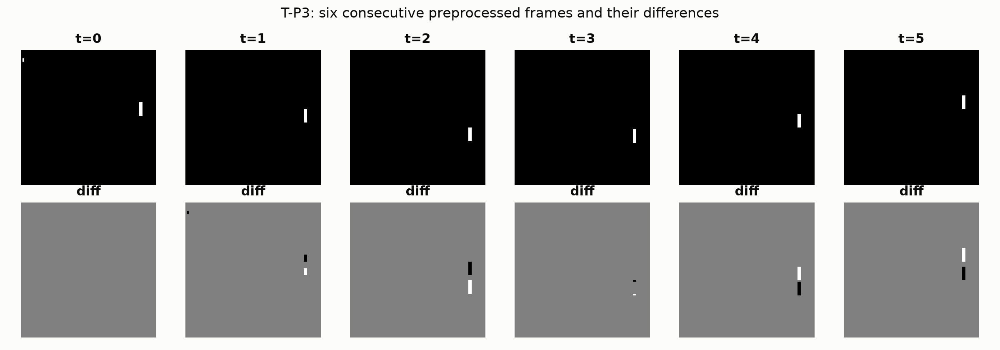

*Figure 22. Top: six consecutive preprocessed frames. The right paddle is the bright vertical mark; the ball is one or two pixels and is easy to miss in a still. Bottom: the frame difference. The first difference is identically zero (no previous frame). Later differences show the paddle and the ball moving, with values in `{−1, 0, 1}`.*

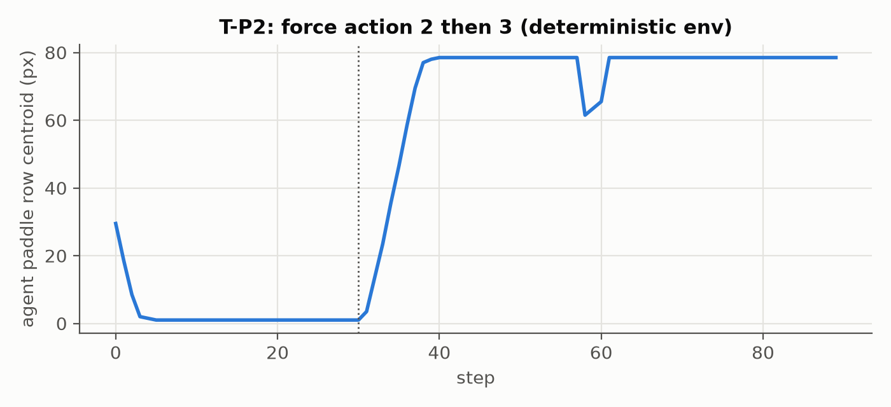

*Figure 23. Deterministic environment, action 2 for 30 steps then action 3 for 60. The right-paddle centroid travels tens of pixels and reverses. Action 2 decreases the row; action 3 increases it. The scripted controller in T-P9 uses that sign.*

### Throughput

Random-policy benchmark on deepdish (`results/pong_bench.json`):

| workers | env steps/s | episodes/s |
|---|---|---|
| 1 | 1826 | 1.66 |
| 8 | 5234 | 4.75 |
| 16 | 9497 | 8.84 |
| 24 | 12726 | 12.08 |
| 32 | 14372 | 13.70 |

At 16 workers a random episode is about 9 per second, so 2000 episodes is a few minutes if rallies stay short. Once lr = 0.01 lengthens the rallies to ~3000 steps the same 16 actors do about 5 episodes/s. The 4-hour budget at 32 workers would cover about 197,000 random episodes; the runs are capped at 25,000 regardless.

### Where the decisions are

Every departure from the pre-registered list D1–D10 is in `DECISIONS.md`. The ones that change how to read the results: the primary estimator uses `w_t = 1` (D1); Pong returns reset at points (D2); CartPole lr 0.01 with one episode per update is the primary result even though its five-seed average MA100 is 88, and C7/C8 are labeled fallbacks (D20); the Pong learning rate stayed at 0.01 because the sweep said so (D24); the value-baseline fit in T-B5 uses thousands of Adam epochs because a few dozen cannot leave the initialization (D22).
